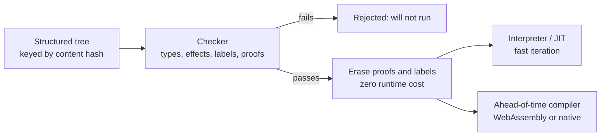
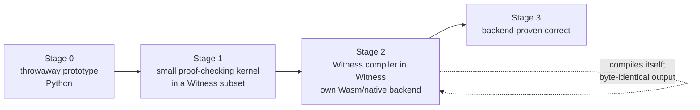

# Witness — Design

> A programming language designed to be used by AI and audited by people.
> **The compiler tracks where data came from and where it is allowed to go.**

Most serious production incidents are not crashes. They are correct-looking code
sending the right data to the wrong place: a silent fallback branch, a secret in a
log line, a value in minutes passed where seconds were expected, a background job
that quietly stopped. Witness is designed so that each of those is a compile error.

---

## 1. Core attributes

| # | Attribute | What it means | Failure it prevents |
|---|-----------|---------------|---------------------|
| 1 | **Exhaustive matching, no silent fallthrough** | Every `match` covers every case. Wildcard arms do not exist; a new variant breaks every match that must handle it. | A dispatch whose final `else` routes unrecognised input to a default destination. |
| 2 | **Information-flow labels** | Values carry labels such as `Secret`, `Unsanitised`, `tenant:acme`. Labels propagate through computation and cannot reach a sink that does not accept them. Release is an explicit, signature-visible `declassify`. | Unsanitised prompts sent to an external service; secrets in logs; cross-tenant leakage. |
| 3 | **Effects in signatures** | `fn collect(site) -> Edges uses Net, Clock, Log`. Pure by default. Network, disk, clock, randomness and console are visible in the type. | Hidden I/O; untestable code; capabilities granted by accident. |
| 4 | **Resource lifetimes** | Holding a handle after it was closed is a type error. Shared ownership by default; stricter ownership opt-in. | Using a connection pool another component already closed. |
| 5 | **Structured concurrency with deadlines** | Every task has a parent and a cancellation scope; budgets propagate. No fire-and-forget. | A background job silently stalled for weeks. |
| 6 | **No null, no implicit conversion, units in types** | `Option[T]`, `Duration`, `Bytes`, `Seconds` vs `Minutes`; refinements such as `Port` and `NonEmpty[Str]` checked at the boundary. | `interval_minutes` passed as `budget_s`. |
| 7 | **Contracts, proved not tested** | A function states what it needs and what it guarantees (`requires` / `ensures`); the checker proves both and erases them, and no recursion is accepted without a measure that falls. | A precondition documented in a comment and violated at one of forty call sites. |
| 8 | **Errors are values, with context** | No exceptions crossing module boundaries silently; adding context is one operator. | Failures that surface far from their cause. |
| 9 | **Schema-first data** | Records declare their wire form and version; migrations and compatibility are checked at build time. Partial update and full replace are different types. | A partial update that silently drops every field it didn't mention. |
| 10 | **Gradual strictness that only ratchets** | REPL-friendly and inferred while exploring; strictness can be raised per module, never lowered. | Prototypes that never become safe. |

**Tooling is part of the language:** one formatter, one build, one package manager;
hermetic, deterministic builds and tests; property and snapshot testing in the
standard library; diagnostics that propose a fix.

**Deliberately left out:** inheritance, global mutable state, syntax-rewriting
macros, more than one async model, exceptions as control flow, null, a mandatory
tracing garbage collector, fast-math by default, unsynchronised shared mutable state,
silent integer overflow.

**Native from the start** (see §8): machine learning and edge AI; one language from
microcontroller to supercomputer; parallelism, IPC and multithreading.

**Also built in from the start** (see §9): foreign interop as a labelled boundary,
supervision, observability, checked integers, distinct time types, energy budgets,
fleet updates, record and replay, durable state, `Str` distinct from `Bytes`.

---

## 2. Designed for AI authors

If the primary author is an AI, the bottleneck moves from **writing** code to
**verifying** it. AI produces plausible code in volume; confidently-wrong code is
its characteristic failure. So the trade-offs change.

### Strengthened

- **Proofs instead of tests.** Formal verification is rare because proofs are
  tedious for people. An AI discharges proof obligations cheaply, so every function
  carries a machine-checked contract (requires / ensures / invariants). Tests become
  a backstop.
- **Explicit everything.** Type inference exists to save human keystrokes; an AI
  writes the full type for free, and an inferred type is information a later reader
  must reconstruct. Types, effects, units, labels and lifetimes are stated at every
  boundary.
- **Labels and effects are mandatory**, not opt-in per module. They are exactly the
  checks that catch plausible-but-wrong code.

### Changed

| Human-oriented choice | AI-first replacement |
|---|---|
| Text files + formatter | A structured tree is the stored form; exactly one way to write each construct |
| References by name | References by content hash: calling a nonexistent function cannot compile, renames cannot break callers |
| Prose error messages | Machine-readable diagnostics naming the violated rule, with candidate fixes |
| Comments | Intent stored as checked data: specification, assumptions and rationale linked to each definition |
| Gradual strictness | Maximum strictness from the start |
| REPL convenience | Small pieces, each checked in isolation |

### Added for AI's own weaknesses

- **Locality.** Context windows are finite, so every unit is understandable from its
  own signature and contract. No action at a distance: no global state, no implicit
  imports, no behaviour that depends on what else is loaded.
- **Determinism.** The same inputs always produce the same build and behaviour, so
  regenerated code can be compared directly with what it replaces.
- **A small, regular core.** There is no training corpus for a new language, so it
  must be small and formally specified enough to learn from its definition alone.
  That definition is [PRIMER.md](PRIMER.md); the test suite checks every example in it.
- **Token cost is a design constraint.** Explicitness aids checking but costs
  context; a compact encoding is welcome as long as nothing is resolved implicitly.

### Not dropped: human readability

Readability moves from the authoring format to a **guaranteed, lossless audit
view** that cannot be bypassed. Someone must be accountable for what the system
does; if people cannot read what the AI wrote, they cannot trust it, approve it, or
tell when it is wrong. AI-native underneath, faithful human projection on top.

---

## 3. Name

**Witness**, file extension **`.wtn`** (`.wit` is taken by WebAssembly Interface Types).

- In proof theory, a *witness* is the concrete evidence that a claim holds — every
  function carries its proof.
- In accountability, a *witness* is the observer who can vouch for what happened —
  the human audit view.

The machine proves it; a person can see it.

**Short name: W.** Fine in conversation and prose ("written in W"). Witness stays the
canonical name in docs, package metadata and tooling, because:

- *W* already means two things in type theory, the field this language lives in:
  Hindley–Milner **Algorithm W**, and **W-types** (well-founded trees) in dependent type
  theory — which Stage 1 may well implement.
- A single letter is unsearchable, and `w` is a standard Unix command, so the CLI stays
  `witness`.
- The file extension stays `.wtn`.

---

## 4. Execution model — both interpreted and compiled, checked first

- **The checker gate cannot be bypassed.** There is no interpreted mode that skips
  checks; unverified code never runs, in either mode.
- **An interpreter exists regardless.** Dependent types require evaluation during
  checking, so the compiler already contains an evaluator; exposing it gives the
  AI a fast generate → check → run loop.
- **Ahead-of-time compilation for deployment.** Proofs and labels are erased after
  checking, so verification costs nothing at runtime.
  - **WebAssembly is the primary target.** It is portable, sandboxed and
    capability-based. Effects map directly to host-granted capabilities: a function
    declared `uses Net` only works if the host supplies network access, so the type
    system's promises are enforced by the runtime too.
  - **Native code** (Cranelift/LLVM-class backend) where raw speed matters.
- **Content hashing makes compilation mostly a cache lookup.** Each definition is
  checked and compiled once per hash and reused everywhere; deterministic builds
  mean a hash plus a target always yields the same artifact.
- **Runtime checks only at the edges.** Inside the program, constraints are proven.
  Data from outside — network, files, another tenant — is validated once on entry
  and carries its proven type from there.
- **Live upgrade by hash.** Old and new versions of a definition are different
  hashes and can coexist: in-flight work finishes on the old one, new calls use the
  new one, no restart.

---

## 5. Independence from other languages — the bootstrap

Building the toolchain directly in machine code is possible but works against the
design: hand-written machine code is the least auditable artifact there is, it
moves trust rather than removing it (Thompson, *Reflections on Trusting Trust*),
and a proof checker in assembly is where undetectable bugs would live.

The goal is not "no other language" but **the smallest possible trusted base**.
Precedents: stage0 / live-bootstrap (full-source bootstrap from a few-hundred-byte
seed), CakeML (a compiler verified down to machine code, bootstrapped inside a
theorem prover), and every self-hosted compiler.

End state: no host language — a tiny seed, the hardware, and a chain of proofs.
Optional hardening: *diverse double-compiling* (two independent Stage 0s must agree)
against trusting-trust attacks, and a hex seed so anyone can rebuild from almost
nothing. Details and exit criteria: [ROADMAP.md](ROADMAP.md).

The AI angle: an AI could emit machine code directly, but that maximises
unverifiable output. The better use of AI is writing the proofs for a verified
backend, so the machine code it generates can be trusted.

---

## 6. Why Stage 0 is Python

Stage 0 exists to settle semantics, then be thrown away.

- Syntax and typing rules will change many times; Python makes each change cheap.
- Rust's strengths (speed, Wasm/Cranelift crates, memory safety) land in the
  Stage 2 compiler — which is written in Witness, not Rust.
- The Stage 0 checker is not trusted; the Stage 1 kernel is. Host-language
  guarantees would protect the wrong layer.
- A polished prototype tends to become permanent and undermine self-hosting.

Rust would win if Stage 0 had to live for years, emit real Wasm before
self-hosting, or check large programs. To compensate for Python's weaker typing,
the prototype is written with frozen dataclasses and `match`, and the test suite
stands in for compiler guarantees.

### 6.1 Why the prover is built in, not z3

Contracts need a decision procedure. The choice was between calling an external SMT
solver and writing one; Stage 0 writes one
([witness/logic.py](../witness/logic.py)), for three reasons.

- **An external solver's answer is not evidence.** Stage 1 re-checks every judgement
  with a small kernel. A procedure written here can be made to emit the steps it took;
  "z3 said unsat" cannot be re-checked by anything smaller than z3.
- **The fragment is small.** Contracts state integer bounds and boolean combinations of
  them. Quantifier-free linear integer arithmetic covers that, and it is a few hundred
  lines: normalise to a conjunction of linear constraints, then eliminate variables
  (Fourier-Motzkin) with the bounds rounded inwards because the variables are integers.
- **No dependencies.** The toolchain stays a Python standard-library program, which
  matters for a project whose point is a small trusted base.

The cost is incompleteness: the procedure is sound (it proves only what follows) but
gives up on some true goals — anything non-linear, and anything about strings, records
or variants beyond equality. Where it gives up it loses *facts*, never obligations, so a
program that passes really does satisfy its contracts. When the fragment starts to bind,
the answer is a stronger procedure or a proof term the kernel checks — not a dependency.

---

## 7. What Stage 0 implements

| Design attribute | Stage 0 |
|---|---|
| Exhaustive matching, no wildcards | **Yes** — `no-wildcard`, `non-exhaustive`, `duplicate-arm` |
| Information-flow labels | **Yes** — labels on types, propagation through pure ops, `if`/`match` (implicit flow), record fields and type arguments, sinks, explicit `declassify` that must be declared in the signature; no effect in a branch decided by labelled data |
| Effects in signatures | **Yes** — closed effect set; undeclared effect is an error, unused is a warning |
| Units / no implicit conversion | **Yes** — nominal `newtype`s, explicit wrap/`unwrap` |
| No null | **Yes** — there is no null; absence is `Option`, failure is `Result` (prelude) |
| Structured, rule-tagged diagnostics | **Yes** — every diagnostic names a rule and proposes fixes; `--json` |
| References resolved, no hallucinated APIs | **Yes** — unknown names fail with did-you-mean fixes |
| Content-addressed definitions | **Yes** — name- and parameter-name-independent hashes; Merkle dependencies; arm order normalised; a local object store |
| Checker gate before execution | **Yes** — `run`, `hash`, `store` and `export` refuse unchecked programs |
| Effects as host capabilities | **Yes** — `run --grant` must cover `main`'s declared effects; builtins re-check at runtime |
| Human audit view | **Yes**, and two-way — `view` projects a module for a reader and `read` takes it back in, with every definition returning the hash it had. It is verified to hide nothing a signature says |
| Labels/proofs erased at runtime | **Yes** — the interpreter carries no labels |
| Errors are values, with context | **Yes** — failure is `(Err e)`; the prelude's `Fault` carries where, why and the cause it wrapped, and `context` adds a layer. It is a generic prelude function, so "one operator" costs the core nothing. A `Fault` holds unlabelled text, so putting labelled data in a message is a visible release |
| Contracts and proofs | **Partly** — `requires` / `ensures` proved statically by a built-in decision procedure (§6.1) and erased before execution; termination proved for every recursion. Proofs are not yet *evidence* a kernel can re-check — that is Stage 1 |
| Structured concurrency | **Yes** — every task has a parent that waits for it, a mandatory deadline and a mandatory failure policy; placement decides how far it runs, and a trace id follows the task tree |
| Resource lifetimes | Not yet — there are no handles to hold past their close, because there is no mutable state |
| Termination | **Yes** — every recursive cycle needs a measure (a `match` binder, or an `Int` that falls while provably above zero); without it an `ensures` would be vacuous |
| Records, schemas, versioning | **Yes** — records (`make` / `get` / `with`, no defaults, one field order), wire schemas with versions whose compatibility is checked between consecutive versions, and partial update as its own type (`patch` / `update`) |
| Refinement types | **Yes** — a `newtype` may carry a condition proved where a value is built, and relied on as a fact everywhere the type appears |
| Generics | **Yes** — generic enums and generic functions, with type arguments inferred at construction and at each call; rigid inside a body, so nothing may be assumed about a type parameter |
| Label polymorphism | **Yes** — one label parameter per function, `(fn (shout (label L)) ((s (label L Str))) (label L Str) ...)`, solved from the call and rigid in the body; a label also rides through a type parameter |
| Effect polymorphism | Not applicable in Stage 0: it ranges over the effects of a function passed in, and functions are not values, so every call's effects are statically known |
| Wasm / native output | Not yet — Stage 2 |
| Numeric formats | **Yes** — `F16`, `BF16`, `F32` are distinct types with strict IEEE rounding once per operation and no implicit conversion; a decimal literal has no format until one is named. Division answers an `Option` rather than a NaN |
| Tensors with shapes in the type | **Yes** — element format and named axes are part of the type; a matrix product contracts by axis name as well as size, so a transposed argument is a compile error |
| Models as values, labels through training | **Yes** — a model is named by the hash of its weights and states what it was trained on; an answer carries `ModelOutput`, the input's labels and the training labels, so prompt injection is an information-flow error |
| Accelerators as effects | **Yes** — `Gpu` and `Npu` come from the model's device; a profile may refuse them |
| Autodiff, quantised tensors | Not yet |
| Target profiles, `Alloc` effect | **Yes** — `Alloc` is the effect of building a dynamically sized value; `host`, `embedded` and `mcu` are effect sets, and a definition builds for a profile exactly when its effects fit. Profiles are not dialects |
| Resource bounds | **Yes** — `(bounds (depth N) (alloc N) (repeats N))` on a function, proved by a static cost pass that uses the prover to bound a recursion's measure; mandatory on the `mcu` profile. Worst-case execution time needs a hardware timing model and is not attempted |
| Parallelism, data-race freedom | **Yes** — `par` is fork-join and deterministic by default (values are immutable, so a data race cannot be written); an effect in a branch is `Nondet`, in the signature. Structured tasks have parents, mandatory deadlines and mandatory failure policies (`fail`, `escalate`, `restart N`) |
| One model across scales | **Yes** — a branch or task says how far it may run: `inline`, `thread`, `core` (the default, so multi-core needs no ceremony), `process`, `node`. Shared-memory placements carry anything because values are immutable; `process` and `node` copy over a wire, so what crosses must have a schema. The profile says how far work may go |
| Typed IPC | **Yes** — `(channel Name Payload (accepts Label...))` with `send` / `recv` under an `Ipc` effect; the payload declares a wire schema, and label acceptance is checked at the sender |
| Foreign interop | **Yes** — `(foreign ...)` has no body, costs the `Foreign` effect at every call, returns an `Unverified` result, and runs only if the host supplies an implementation |
| Observability | **Partly** — structured log fields with per-label redaction; the raw value never reaches the sink, and the policy is part of the caller's hash. Every line carries the trace id of the task that wrote it, propagated by the task tree itself. Metrics not yet |
| Durable state, record and replay | **Yes** — a `Store` effect whose put is one assignment, and a journal of every effect performed: replaying answers from the journal without performing anything again, so a run reproduces exactly and a workflow resumes rather than redoes |
| Supervision | **Yes** — every task declares `fail`, `escalate` or `restart N`; there is no default |
| Checked integers | **Yes** — `Int` is unbounded; `I8`…`I64` and `U8`…`U64` are machine integers whose every operation is proved in range, with wrapping and saturating as separately named operations and no implicit widening |
| `Str` / `Bytes` | **Yes** — `Str` is valid text, `Bytes` is raw; encoding is total, decoding returns a `Result`; lengths carry their unit (`Chars`, `Octets`) and do not mix |
| Time types | **Yes** — `Instant`, `WallTime`, `Ticks` and `Duration` are distinct; each clock has its own reading builtin under the `Clock` effect, and a `Duration` is a difference within one clock. No conversions between clocks, no time zones |
| Record and replay | **Yes** — every effect can be journalled, and a replay answers from the journal without performing anything again |
| Energy budgets, fleet updates | Not yet |

---

## 8. Native from the start: ML, every scale, parallelism

Three requirements are foundations, not libraries added later. Each is expressed
through mechanisms the language already has — types, effects, labels, content
hashes — rather than new special cases.

### 8.1 Machine learning and edge AI

- **Tensors with shape and element type in the type.** `Tensor[F32, (Batch, 128)]`;
  a shape mismatch is a compile error, the same way a unit mismatch is. Axes are
  named, so `(Batch, Features)` cannot be silently transposed. This uses the
  dependent types Stage 1 needs anyway.
- **Numeric formats are types, including quantised ones.** `F32`, `F16`, `BF16`,
  `I8`, fixed-point. A quantised tensor carries its scale and zero-point in its
  type, so mixing quantisation schemes is a unit error. Conversion is explicit.
- **Differentiation is a compiler transform**, not a tape library. `grad f` is
  checked like any other function and is defined only for pure, differentiable `f`.
- **Models are content-addressed values.** Architecture and weights hash like
  definitions; an inference call names the exact model it runs.
- **Labels flow through training.** A model trained on `tenant:acme` or `Personal`
  data carries those labels on its weights; inference output carries the labels of
  both input and model. Releasing such a model is a signature-visible `declassify`;
  differential privacy and federated aggregation are declassification mechanisms
  that must state their privacy budget.
- **Model output is untrusted by default.** Generative output is labelled
  `ModelOutput` and cannot reach a sink that executes or trusts it (shell, query,
  another model's instructions) without validation. Prompt injection becomes an
  information-flow error.
- **Accelerators are effects.** `uses Gpu`, `uses Npu`: code that needs one says so;
  the host decides placement.
- **Edge first.** Inference must fit a proven memory budget (§8.2); on-device
  training and fine-tuning are allowed but bounded the same way.

### 8.2 Microcontroller to supercomputer

One language, one semantics. Targets differ only in which capabilities the host
grants and which resource bounds must be proven.

- **Target profiles are effect sets.** A profile (`mcu`, `embedded-linux`, `server`,
  `hpc`) is the set of effects and resources a host provides. A definition builds for
  a profile if and only if its declared effects fit. Profiles are not dialects.
- **Allocation is an effect.** Code without `uses Alloc` performs no heap
  allocation and runs without an allocator. There is no mandatory garbage
  collector: shared ownership (§1 #4) is reference counting plus regions, and
  cycles are prevented by type rather than collected.
- **Resource bounds are proof obligations.** Stack depth, heap high-water mark and
  loop bounds are stated in contracts and proven; on `mcu` they are mandatory.
  Worst-case execution time is provable where a hardware timing model exists.
- **Freestanding core.** The core needs no OS, floating point or threads; each
  arrives as an effect. Hardware registers and interrupts are typed capabilities
  (`uses Irq`); volatile access is explicit.
- **Backends.** Wasm stays the portable, sandboxed target (small Wasm runtimes run
  on microcontrollers). Native freestanding code (Cortex-M, RISC-V class) where Wasm
  overhead is too high; native plus GPU kernels for servers and HPC.
- **Scale by placement, not rewriting.** Parallel code (§8.3) states what *may* run
  concurrently; the profile decides on how many cores, nodes or devices.

### 8.3 Parallelism, IPC and multithreading

Extends structured concurrency (§1 #5).

- **Data-race freedom by type.** Values crossing a task boundary are immutable or
  transferred (ownership moves); shared mutable state requires an explicit
  synchronised type. A data race does not compile.
- **Deterministic by default.** `par`, `par.map`, fork-join and reductions give the
  same result as sequential evaluation, including a fixed floating-point reduction
  order so ML runs reproduce. Observable nondeterminism (racing select,
  first-to-finish) is an effect, `uses Nondet`, visible in the signature.
- **One model across scales.** Tasks in a thread, threads in a process, processes
  on a host and nodes in a cluster are the same structured-task abstraction with
  different placement. Cost differs; semantics does not.
- **IPC is typed, schema-first and labelled.** A channel carries a schema (§1 #9)
  and the labels its receiver accepts; sending `Secret` data to a receiver that
  does not accept it is a compile error even across processes. Wire forms are
  versioned so the two ends upgrade independently (live upgrade by hash, §4).
- **Cancellation and deadlines cross every boundary** — thread, process, node — so
  a child on another machine is cancelled with its parent.
- **Collectives for HPC** (broadcast, reduce, all-reduce, scatter, gather) are
  library functions over the same task model, with deterministic reduction.
- **Atomics and lock-free code live in a small, separately verified layer**, not in
  ordinary code.

### 8.4 Tensions and resolutions

| Tension | Resolution |
|---|---|
| Determinism (§2) vs parallelism | Deterministic parallelism by default; nondeterminism is an effect |
| Shared ownership by default (§1 #4) vs microcontrollers | Reference counting and regions, no tracing GC; allocation-free code needs no runtime |
| Wasm as primary target vs constrained hardware | Wasm remains the portable default; a native freestanding backend for constrained targets |
| Floating point vs reproducibility | Strict IEEE semantics; fixed reduction order; relaxed modes are explicit opt-ins |

---

## 9. Also built in from the start

### 9.1 Foreign code is a labelled boundary

The ML ecosystem lives in C, Python and model runtimes; Witness must reach it
without opening a back door.

- A `foreign` declaration gives a full Witness signature for code the checker cannot
  see. The signature is trusted; nothing else is.
- Every foreign call has the effect `uses Foreign`, and its results are labelled
  `Unverified` until validated at ingress — exactly like network data (§4).
- Foreign code runs isolated where the target allows (a separate Wasm instance or
  process) and receives only the capabilities granted to it explicitly.
- External model formats (ONNX and similar) import as model values (§8.1), with
  shapes and numeric formats checked at import.

### 9.2 Supervision

- Every task's parent declares what happens when it fails: restart (with backoff
  and a limit), escalate, or fail. There is no default.
- **Liveness is a contract.** A periodic task declares its cadence; missing it is a
  failure delivered to its parent, not silence. A job cannot stall unnoticed.
- An exhausted restart budget escalates up the task tree to a root that must
  handle it.

### 9.3 Observability

- Tracing spans follow the task tree automatically; trace IDs propagate across
  threads, processes and nodes with IPC (§8.3).
- Logs and traces are sinks. A structured log field may carry a labelled value only
  through a redaction policy declared for that label; the raw value never reaches
  the sink.
- Metrics are typed and carry units (§1 #6).

### 9.4 Integer arithmetic

- Integers have explicit widths; there is no implicit widening or narrowing.
- Overflow must be proven impossible or handled as a value. Wrapping and saturating
  arithmetic are distinct, explicitly named operations.

### 9.5 Time

- `Instant` (monotonic), `WallTime` (UTC) and `Ticks[Hz]` (device clock) are
  distinct types; `Duration` is the difference between two values of the same kind.
- Conversions between clocks are explicit and use the `Clock` effect. Time zones
  exist only at the presentation edge.

### 9.6 Energy and power budgets

- Energy is a resource like memory (§8.2): contracts may bound energy, radio
  time-on-air or duty cycle, proven against the target profile's cost model.
- Radios, sensors and sleep states are effects, so their use is visible and
  boundable.

### 9.7 Fleet updates

- A deployable artifact is a set of hashes signed by its publisher. A device
  verifies signature and hashes before installing.
- The capabilities an artifact needs are part of its signed manifest, so an update
  cannot silently gain privileges.
- Rollout is staged (canary, percentage, all) and gated on health contracts; a
  failed stage rolls back to the previous hash automatically. Old and new versions
  coexist during the switch (live upgrade, §4).
- Only changed definitions are transmitted, because unchanged ones keep their hash.
- Persisted state migrates forward and back through versioned schemas (§1 #9).

### 9.8 Deterministic record and replay

- Every source of nondeterminism enters through an effect (`Clock`, `Net`, `Irq`,
  `Nondet`, …). Recording effect results at the capability boundary is therefore
  enough to replay a run exactly, including concurrent runs, whose scheduling
  choices are `Nondet` results.
- A simulation profile replaces hardware capabilities with recorded or synthetic
  traces, so device code is testable without the device.
- A recording carries the labels of the data it contains: a trace holding `Secret`
  data is itself `Secret`.

### 9.9 Durable state

- Persistent writes use `uses Store` and are atomic: a durable update is a
  transaction, and a partial write is never observable.
- **Durable workflows** journal each step's effect results — the same mechanism as
  replay (§9.8) — and resume after a crash, restart or upgrade.
- A step that is not idempotent must declare it; the checker requires it to be
  journaled before it can be retried.

### 9.10 Text and bytes

- `Str` is always valid Unicode; `Bytes` is raw. Converting `Bytes` to `Str` is
  decoding, with an explicit error case.
- Lengths and indices state their unit — bytes, code points or grapheme clusters —
  and do not mix (§1 #6). Normalisation is explicit, and comparisons state which
  normalisation they assume.
